# Chipova

Design chips **together, with AI agents**, from RTL to a GDSII layout or an FPGA bitstream. Everyone in a project edits the same Verilog live, each with their own cursor; an AI proposes changes that people accept or reject; every lint, simulation, synthesis, FPGA, SPICE, RTL-to-GDSII and layout check runs in a sealed container on a frozen snapshot, and every result can be traced back to exactly the sources, settings and tool versions that made it.

Built with [Reflex](https://reflex.dev/) for the [re-ddns](https://github.com/milochen0418/re_ddns) Agentic App Store: install it there and open `https://chipova.reflex-ddns.com`. It also runs on its own, next to a Docker daemon. It follows the *Agentic IC Design Studio* blueprint ([docs/product-spec.md](docs/product-spec.md)); [docs/status.md](docs/status.md) says, item by item, what is built, what is verified, and what is not done yet.

> **Not a foundry signoff.** Chipova runs open-source tools on open PDKs. Their results are for learning, prototypes and test chips: SkyWater calls SKY130 an *experimental preview*, and a foundry's acceptance needs its own rules, its own checks and people with its authority. Chipova never marks anything foundry ready on its own.

## 📸 Interface Preview

| Projects start from a template | Two people in one file, live |
|:---:|:---:|
| 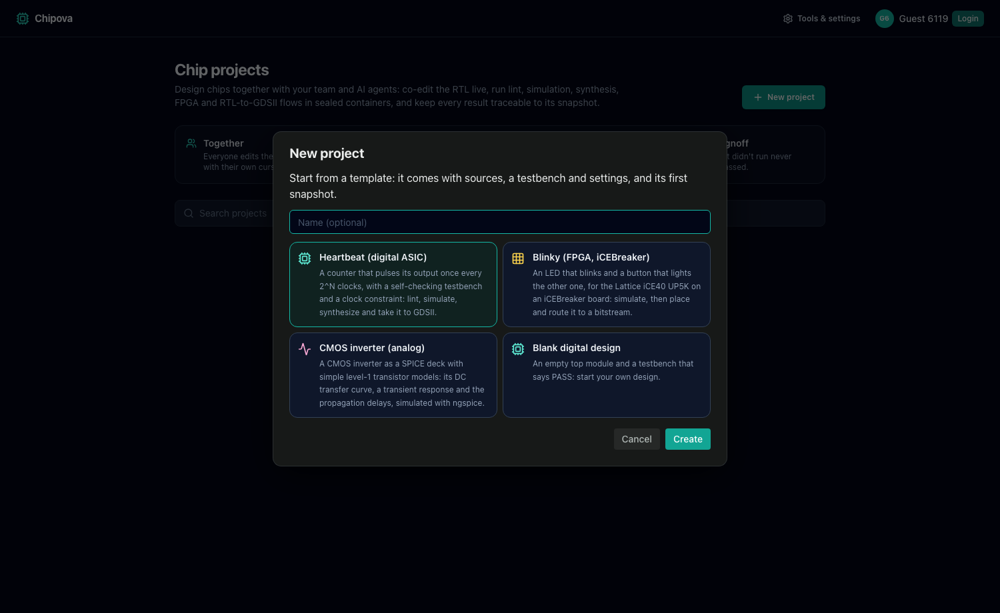 | 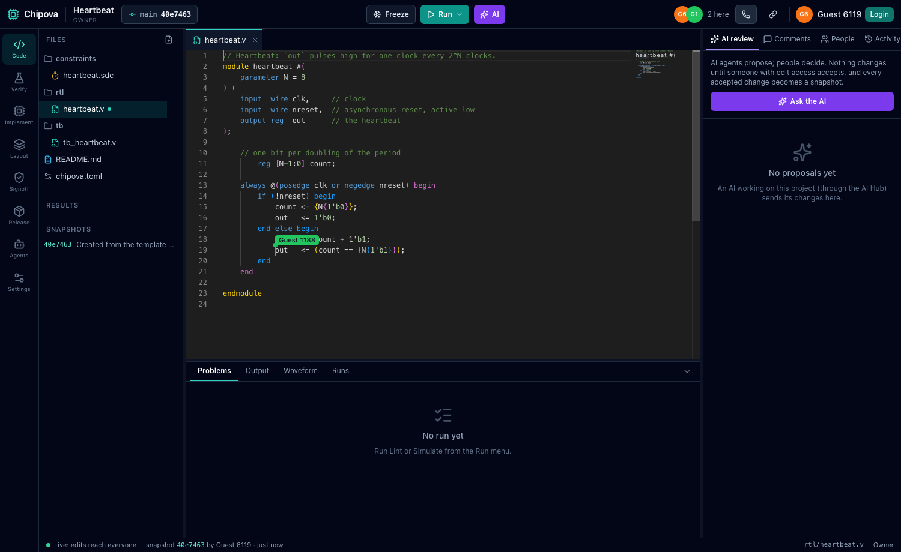 |

| An AI's proposal, waiting for people | The simulation and its waveform |
|:---:|:---:|
| 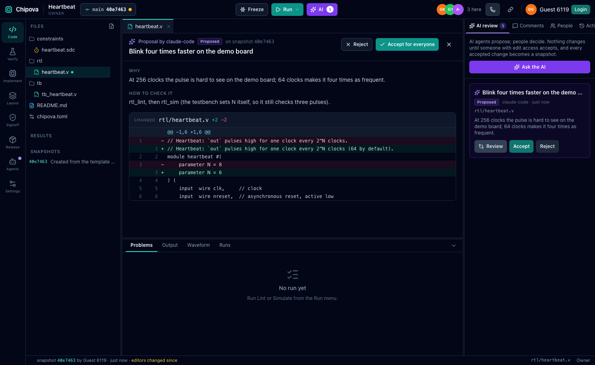 | 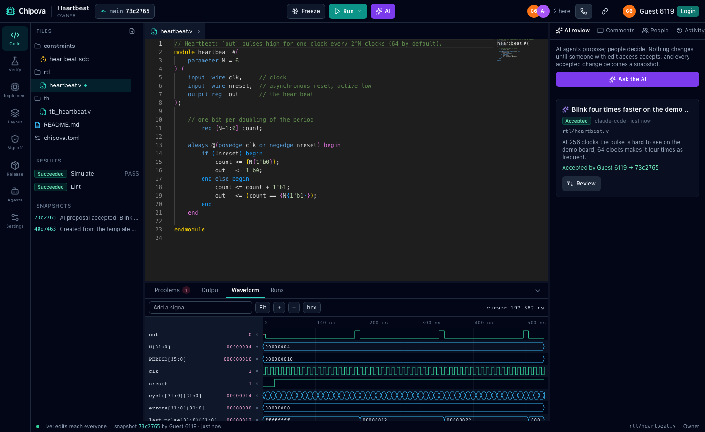 |

| RTL → GDSII with SiliconCompiler | The layout, drawn by KLayout |
|:---:|:---:|
| 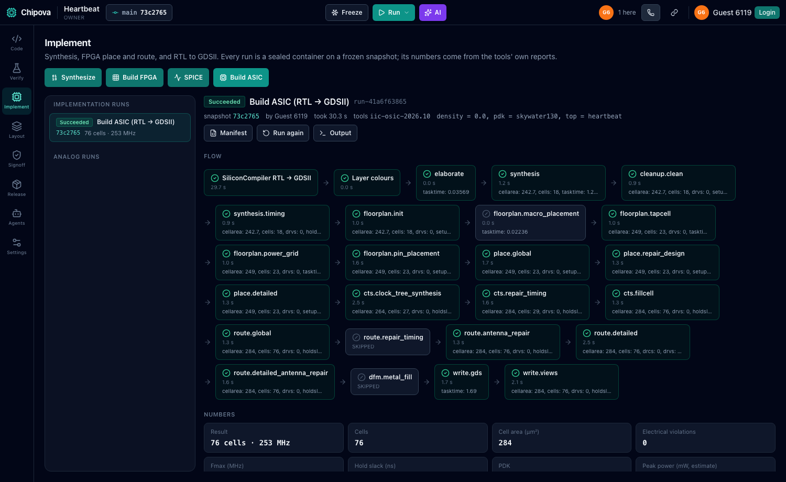 | 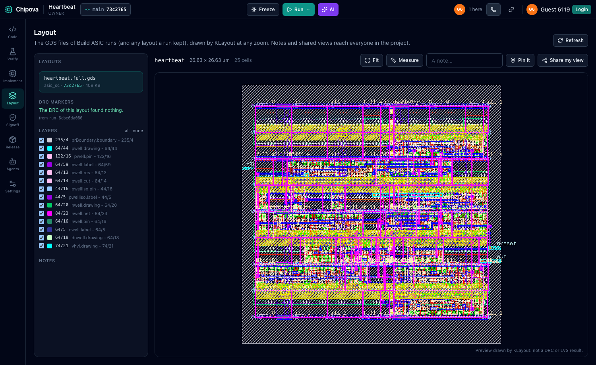 |

| Signoff: each check from its own run | A release held at its gate |
|:---:|:---:|
| 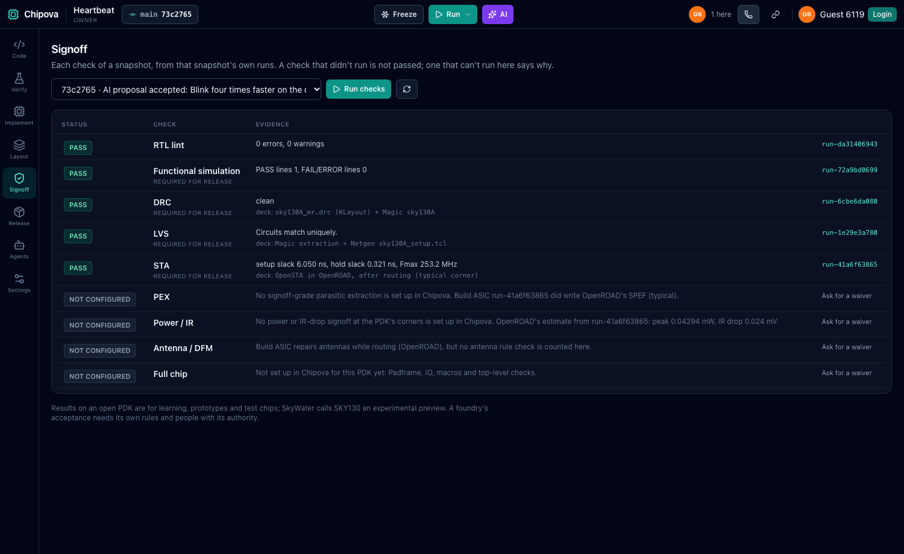 | 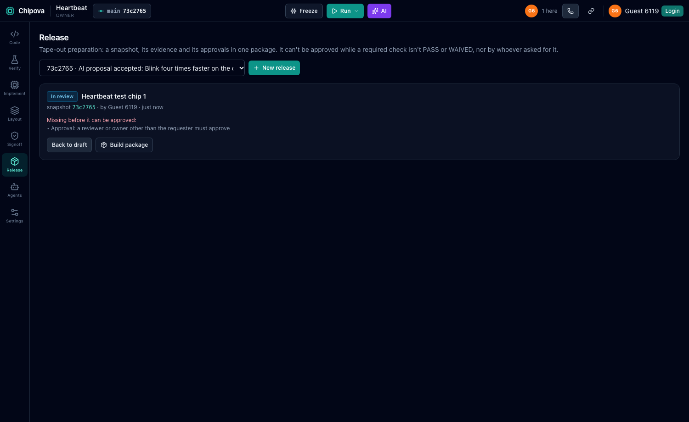 |

| SPICE: an inverter's curves | Everything the AI did |
|:---:|:---:|
| 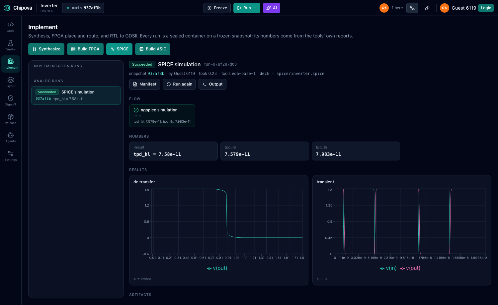 | 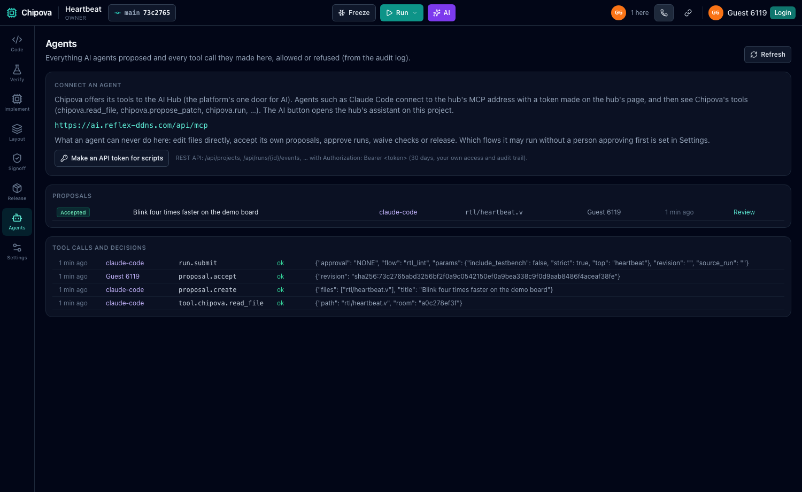 |

| The projects | The tool images and their versions |
|:---:|:---:|
| 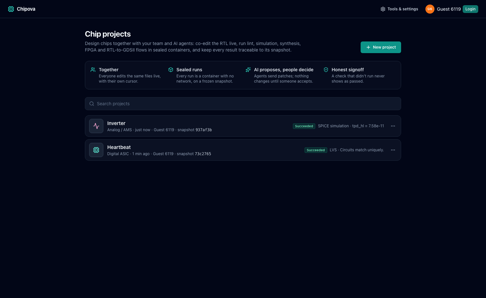 | 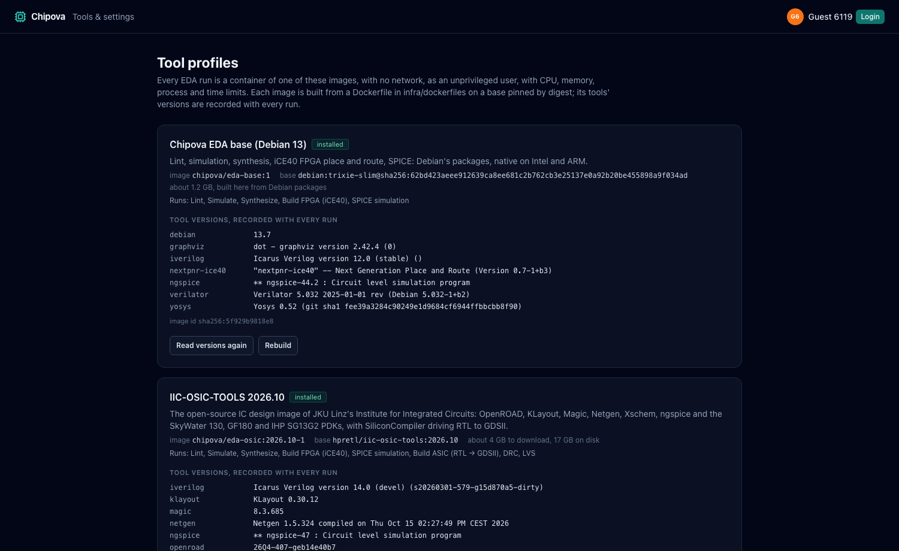 |

*All pictures are from the live app at `chipova.reflex-ddns.com`, with real runs.*

## 🌟 Features

**Projects**
- Four templates: **Heartbeat** (a counter for RTL to GDSII, with a self-checking testbench and a clock constraint), **Blinky** (an iCEBreaker board's LED and button, iCE40 UP5K), a **CMOS inverter** (a SPICE deck) and a **blank** design. Each comes with its first snapshot.
- A project's settings (top module, testbench, PDK, FPGA part and pin file, SPICE deck) are in its `chipova.toml`, edited as a file or as a form on the Settings page; two people saving the form at once don't overwrite each other: the second is told.
- **Who may do what**: anyone with the link may edit (the default), only view, or nobody but the members. Members are **Owner**, **Editor**, **Reviewer** or **Viewer**; someone without access can **ask for access**, and the owner says yes with a role.

**Together**
- The editor is Monaco (VS Code's). Everyone in a file types at once and sees the same text, with each other's carets and selections in their colours and names (Yjs). A dropped connection catches up when it comes back; edits are kept on the server as they are typed.
- Who is here, who has which file open, comments on a line (resolved when done), the project's activity, and **Call everyone** (rings everyone in the project through an installed call app).

**Snapshots** (a run never uses half-typed text)
- **Freeze** makes a snapshot of the files: a git commit, named by the SHA-256 of its files (the same files always give the same snapshot). Runs only use snapshots: **Run** with unfrozen edits asks to freeze them first or to use the latest snapshot.
- Each snapshot shows what it changed from another one, its runs, and its **reviews** (approved, changes requested, commented): a review belongs to its snapshot and never carries over to a later one. **Put these files back** restores a snapshot's files for everyone, as a new snapshot.

**Runs**: real tools in sealed containers
- **Lint** (Verilator `--lint-only -Wall`, and Icarus elaboration), **Simulate** (Icarus or Verilator; a testbench line starting with `FAIL` or `ERROR` fails the run), **Synthesize** (Yosys: cell counts, a gate-level netlist, the RTL schematic), **Build FPGA** (Yosys `synth_ice40`, nextpnr against the pin file, icepack: a bitstream and its Fmax), **SPICE** (ngspice: its `.meas` results and the tables `wrdata` writes, as charts).
- **Build ASIC**: SiliconCompiler 0.38.10 (its current `Design` / `ASIC` API) drives Yosys, OpenROAD and KLayout through synthesis, floorplan, placement, clock tree, routing and GDS on SkyWater 130 or IHP SG13G2, offline. Its flowgraph's 23 steps show live, each with its time, its numbers (cell area, slack, DRVs…) and its log.
- **DRC** (KLayout's `sky130A_mr.drc` deck and Magic) and **LVS** (Magic's extraction and Netgen) check the full layout of a Build ASIC run.
- Every run is a Docker container with **no network**, as an unprivileged user, all capabilities dropped, with CPU, memory, process and time limits; the sources are read-only. Its states are real: Created, Waiting for approval, Queued (with its place), Running, Succeeded, Failed, Canceled, Timed out.
- A run's **problems** (tool, file, line) go to the editor as markers, and a click goes to the line. Its **artifacts** (logs, VCD, netlists, GDS, bitstreams, reports) download with their SHA-256 (checked again on demand), through links signed for the person. Its **manifest** says what went in and came out: the snapshot and its files' hashes, the settings, the image id and the tools' versions, each step's command, the limits, the artifacts' hashes. **Compare** lines two runs up: what went in, their numbers (cells, area, slack, Fmax…), what came out.

**Waveforms and layouts**
- The waveform viewer reads the run's VCD on the server and draws any part of it at any zoom: search signals, a cursor with values, hex or decimal.
- The layout of a Build ASIC run is drawn by KLayout at any zoom, with its layers; DRC findings show as markers (a click goes there); measure, notes and **share my view** reach everyone. It says what it is: a picture, not a DRC or LVS result.

**AI agents propose, people decide**
- Chipova offers 15 tools to the platform's AI Hub (`chipova.read_file`, `chipova.propose_patch`, `chipova.run`, `chipova.read_log`, `chipova.waveform`, …), so an AI such as Claude Code works on a project like a member: the **AI** button opens the hub's assistant on it.
- An AI never edits a file: it **proposes** whole new files with why and how to check them. People see the diff, then **accept** (applied for everyone, merged with what they typed meanwhile, and frozen as a snapshot) or **reject** with a reason the AI reads.
- By default an AI may lint and simulate on its own; any other run it asks for waits until a person approves it (which flows may run without approval is in Settings). An AI can never accept proposals, approve runs, review snapshots, or approve waivers or releases, whoever it works for.
- Every tool call, reading ones too, and every refusal is in the project's audit log, on the Agents page.
- Scripts and other agents can use the **REST API** (projects, snapshots, runs with server-sent events, artifacts, proposals, reviews, releases, signoff) with a token made on the Agents page.

**Signoff and release**
- The **Signoff** page lists each check of a snapshot (lint, simulation, FPGA timing, DRC, LVS, STA, PEX, power/IR, antenna, AMS corners, full chip) as **PASS**, **FAIL**, **RUNNING**, **NOT RUN**, **BLOCKED** (it can't run here, and says why) or **NOT CONFIGURED**, each from a run of that same snapshot. A check that didn't run is never shown as passed.
- A **waiver** needs a reason and someone other than whoever asked for it; a waived check shows as **WAIVED**, never as PASS.
- A **release** of a snapshot goes Draft → In review → Approved or Rejected. It can't be approved while a required check isn't PASS or WAIVED, nor by whoever asked for it; what is missing is listed. Its **package** (a zip) holds the sources, the runs' outputs, the checklist, the approvals and a manifest of hashes. **Foundry ready** is only ever the owner's own written statement.

**Tools & settings** (`/settings`)
- The tool images (installed here, with progress): **Chipova EDA base** (Debian 13's packages, built here, about 1.2 GB) and **IIC-OSIC-TOOLS 2026.10** (JKU's image pinned by digest, plus the PDK data SiliconCompiler needs: about 4 GB to download, 17 GB on disk). Each tool's version is read from the image and recorded with every run. The PDK registry says what each PDK can do here.

## ⚠️ Limits

What Chipova does not do (yet), so nobody has to find out the hard way:

- **Not a foundry signoff**, and no commercial PDKs. DRC and LVS are set up for **SkyWater 130 only**; IHP SG13G2 builds GDS but has no DRC/LVS here, and GF180 isn't set up. **PEX, power/IR, antenna/DFM and full-chip checks are NOT CONFIGURED**: the Build ASIC run's own estimates are shown beside them as information, not as checks.
- **Analog**: SPICE decks with ngspice only. No schematic editing (Xschem) in the browser, no PVT corners (CACE: the AMS corners check is BLOCKED), no IHP AMS chip template flow, no padframe, bond plan or top-level assembly.
- **FPGA**: Lattice iCE40 only, and Chipova doesn't program boards.
- **Post-silicon** (OpenHTF tests, package planning): not built.
- The browser loads the editor (Monaco, from jsDelivr) and Yjs (from esm.sh): **editing needs internet access**.
- **One computer**: the data is SQLite and files in one folder, runs are containers on the same Docker daemon, and the app needs that daemon's socket (it can start containers on the host): install it only where that is acceptable.
- **Guests** (without signing in) are known by their browser: clearing its storage loses what a guest owned.
- Each run's manifest records the image id, the tools' versions, the commands and the artifacts' hashes, but there is **no SPDX/CycloneDX SBOM per run**; [docs/sbom/](docs/sbom/) has one for the app itself.
- Performance is measured on one machine only (co-editing delay, reconnects, queue waits, reproducible builds: [docs/e2e-test-plan.md](docs/e2e-test-plan.md)); many people in one file, real networks and large layouts are not measured yet.

## 📐 How it works

```
  browser (Reflex pages, Monaco, canvas)          Chipova's backend (Reflex + Starlette, one process)
  ┌──────────────────────────────────┐            ┌──────────────────────────────────────────────┐
  │ pages, project room (SharedState)│ ◀─ /_event ▶│ states: projects, runs, reviews, signoff     │
  │ editor ⇄ Yjs document per file   │ ◀─ WS ────▶ │ /_chipova/yjs/…  co-editing relay (pycrdt)   │
  │ waveform + layout viewers        │ ── GET ───▶ │ /_chipova/wave|layout|a/…  signed per person │
  └──────────────────────────────────┘            │ /api/…  REST (tokens), SSE for runs          │
  AI Hub ── /_ddns_tool/call/chipova.* (JWT) ───▶ │ AI tools → proposals, runs (people decide)   │
                                                   │ job engine: queue → container → collect      │
                                                   └───────┬───────────────────────┬──────────────┘
                     SQLite (metadata, audit) · bare git (snapshots) · run folders │ Docker socket
                                                                                   ▼
                                       one container per run: chipova/eda-base:1 or chipova/eda-osic:2026.10-1
                                       no network · user 1000 · caps dropped · CPU/memory/pids/time limits
```

- **Co-editing**: each file is a Yjs document; the backend holds it too (`pycrdt`), so an accepted AI proposal is applied as an edit everyone sees, and every keystroke is on disk within a second. The socket asks for a ticket signed for the person and checks their access when it connects (and again when it changes); viewers get a read-only connection.
- **Snapshots** are commits in a bare git repository per project, made through a temporary index; a run gets its snapshot with `git archive`, so no run ever reads the live editors.
- **Runs**: the engine checks the flow and its parameters against the flow's definition (no commands, no shell strings), then starts a container of the flow's image with the snapshot, a step list and a small runner. The runner prints markers the engine follows live; at the end it collects the outputs, hashes them, parses problems and metrics, and writes the manifest. A restarted backend picks running containers up again.
- **The layout viewer** asks a KLayout worker process for tiles of the GDS; the **waveform viewer** asks for windows of the VCD, thinned to the screen's width.

More in [docs/architecture.md](docs/architecture.md), and the decisions behind it in [docs/adr/0001-core-decisions.md](docs/adr/0001-core-decisions.md).

## 🚀 Install on re-ddns (Agentic App Store)

Chipova is in the App Store catalog as `chipova`. Its entry gives it the host's Docker socket (runs are containers beside it) and keeps its data in the volume `smart-app-chipova-data`; `backend-paths.txt` sends `/_chipova/` (co-editing, downloads, waveforms, layouts) to its backend.

After installing, open **Tools & settings** and install the tool images: the EDA base first (a few minutes), then IIC-OSIC-TOOLS for Build ASIC, DRC and LVS. The builds use the platform's download cache when it is there.

## 💻 Run locally

```bash
poetry env use python3.11
poetry install
poetry run ./reflex_rerun.sh
```

Open `http://localhost:3000` with Docker running. Projects go to `~/Library/Application Support/chipova` (macOS) or `~/.local/share/chipova`. Without re-ddns everyone is a guest; with `DDNS_AUTH_SECRET` set, the platform's sign-in cookie names people. If ports 3000/8000 are taken: `REFLEX_API_URL=http://localhost:8150 poetry run reflex run --frontend-port 3150 --backend-port 8150`.

## ⚙️ Configuration (all optional)

| Variable | Default | Meaning |
|---|---|---|
| `CHIPOVA_HOME` | `~/Library/Application Support/chipova` (macOS), `~/.local/share/chipova` | Projects, snapshots, runs, the database and this installation's signing key |
| `CHIPOVA_MAX_PARALLEL_RUNS` | `2` | Runs at once; the others wait in the queue in order (each person can have 20 waiting) |
| `CHIPOVA_MAX_OUTPUT_MB` | `2048` | The most a run may leave in its output folder |
| `CHIPOVA_CALL_APP` | (chosen when calling) | The call app **Call everyone** uses |
| `DDNS_AUTH_SECRET` | set by re-ddns | Checks the platform's sign-in cookie and the AI Hub's tool calls |
| `DDNS_AUTH_COOKIE` | `ddns_auth` | The sign-in cookie's name |
| `SERVICE_ZONE` | `reflex-ddns.com` | The platform's domain (for the AI Hub's address) |

## 🔌 REST API

`Authorization: Bearer <token>` (made on a project's Agents page; 30 days, your own access, every call audited), or the platform's sign-in cookie. Bodies and answers are Pydantic models; refusals are 401/403 (and audited), unknown things 404, conflicts 409, bad requests 400.

```
GET  /api/projects                       POST /api/projects                      (from a template)
GET  /api/projects/{id}                  POST /api/projects/{id}/snapshots        (freeze)
GET  /api/projects/{id}/revisions        POST /api/projects/{id}/runs             (a flow on a snapshot)
GET  /api/projects/{id}/runs             GET  /api/runs/{run_id}
GET  /api/runs/{run_id}/events  (SSE)    GET  /api/runs/{run_id}/artifacts        (signed links)
POST /api/runs/{run_id}/approve          POST /api/projects/{id}/agent/propose
POST /api/agent-actions/{id}/approve     POST /api/agent-actions/{id}/reject
POST /api/projects/{id}/reviews          POST /api/projects/{id}/releases
GET  /api/projects/{id}/signoff
```

## 🧪 Tests

```bash
poetry run pytest -m "not docker"      # 23 tests: snapshots, co-editing on disk, access, proposals, signoff, release, compare, REST API, signed links
poetry run pytest -m docker            # 7 tests in real containers: lint/sim/synth, a failing lint, AI approval, a failing SPICE run,
                                       # heartbeat → GDS → DRC → LVS, IHP SG13G2, a backend restart in the middle of a build
poetry run ./run_test_suite.sh smoke_home   # E2E (Playwright), see testcases/README.md
```

The eight E2E suites (`smoke_home`, `collab_live`, `lint_sim`, `ai_review`, `fpga_build`, `permissions`, `signoff_release`, `perf_baseline`) start their own server with a fresh data folder: they never see your projects. [docs/e2e-test-plan.md](docs/e2e-test-plan.md) maps the blueprint's acceptance criteria to them, with the measured baselines (co-editing delay 3 ms median on one machine, reconnects, queue waits, reproducible builds).

## 📚 Docs

- [docs/product-spec.md](docs/product-spec.md): the blueprint Chipova is built from (in Chinese)
- [docs/status.md](docs/status.md): each part of it: implemented, verified, blocked or experimental
- [docs/architecture.md](docs/architecture.md), [docs/ui-flows.md](docs/ui-flows.md), [docs/adr/0001-core-decisions.md](docs/adr/0001-core-decisions.md), [docs/e2e-test-plan.md](docs/e2e-test-plan.md)
- [THIRD_PARTY_NOTICES.md](THIRD_PARTY_NOTICES.md): the libraries, tools and PDKs, and their licenses

## 🩺 Troubleshooting

- **"needs a tool profile that isn't installed"**: install it on Tools & settings (Build ASIC, DRC and LVS need IIC-OSIC-TOOLS).
- **"Docker isn't reachable"** on Tools & settings: the app has no Docker socket. On re-ddns, reinstall it from the catalog; locally, start Docker.
- **A run stays "Waiting for approval"**: an AI asked for it; someone with edit access approves it in the Runs tab (or allow that flow for AIs in Settings).
- **The editor won't take typing**: you are a viewer, or the file is still connecting (the status bar says which). "Refused" means your access changed: reload.
- **A check is BLOCKED or NOT CONFIGURED**: it says why on the Signoff page; it can't pass here, so a release needs a waiver for it (asked by one person, approved by another) if it is required.
- **DRC fails on your design**: click the finding on the Layout page to see where it is; the rule and its count are in the DRC run's report.

## 📄 License

MIT. The tools Chipova runs, the PDKs and the libraries it uses have their own licenses: see [THIRD_PARTY_NOTICES.md](THIRD_PARTY_NOTICES.md).
